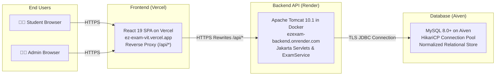

# EzExam — VIT Examination Portal

[](https://react.dev/)
[](https://vite.dev/)
[](https://www.oracle.com/java/)
[](https://jakarta.ee/)
[](https://tomcat.apache.org/)
[](https://www.mysql.com/)
[](LICENSE)

* 🌐 **Live Demo:** [https://ez-exam-vit.vercel.app](https://ez-exam-vit.vercel.app)
* 💻 **GitHub Repository:** [https://github.com/NiharTambe20/EzExam-VIT](https://github.com/NiharTambe20/EzExam-VIT)

---

EzExam is a web-based examination management portal developed as an academic project. It provides students with an intuitive, reliable interface to take examinations, answer questions, manage exam time, submit responses, and view results, along with comprehensive administrative functionality for examination scheduling, question authoring, and performance monitoring.

---

## Table of Contents

- [Key Features](#key-features)
- [Screenshots](#screenshots)
- [Technology Stack](#technology-stack)
- [System Architecture](#system-architecture)
- [Installation and Local Setup](#installation-and-local-setup)
  - [Prerequisites](#prerequisites)
  - [1. Clone Repository](#1-clone-repository)
  - [2. Database Setup](#2-database-setup)
  - [3. Backend Setup](#3-backend-setup)
  - [4. Frontend Setup](#4-frontend-setup)
- [Environment Variables and Secrets](#environment-variables-and-secrets)
- [Demo Credentials](#demo-credentials)
- [API Documentation](#api-documentation)
- [Testing](#testing)
- [Deployment](#deployment)
- [Security Notes](#security-notes)
- [Academic Project Disclaimer](#academic-project-disclaimer)
- [License](#license)
- [Contributors](#contributors)

---

## Key Features

### 👨‍🎓 Student Examination Experience
* **Authentication & Session Management:** User registration and login with salted BCrypt password hashing and stateful HTTP session tracking (`HttpSession`).
* **Examination Catalog:** View available published exams with duration, total marks, passing percentage, and question counts.
* **Pre-Exam Briefing:** Instructions and acknowledgement screen outlining test rules before initiating an attempt.
* **Authoritative Timed Exam Runner:** UTC-synchronized countdown timer with automatic submission upon time expiration and protection against local browser timezone drift.
* **Interactive Question Palette:** Visual navigation indicators distinguishing Answered, Flagged for Review, Visited, and Unvisited questions.
* **Answer Persistence:** Client-side answer caching via browser `sessionStorage` preventing accidental answer loss during page refresh or network hiccups.
* **Integrity by Design:** Correct answer keys are strictly withheld from student API responses to prevent client-side inspection.
* **Automated Scoring & Evaluation:** Immediate server-side evaluation supporting positive marking, negative marking deductions, overall percentage, and pass/fail thresholds.
* **Detailed Results & Attempt History:** Comprehensive student scorecard displaying score breakdown (correct, wrong, unanswered) and past attempt history.

### 👨‍💼 Administrator Console
* **Analytics Dashboard:** Real-time counters for registered students, total exams, published exams, and completed student attempts.
* **Audit Trail:** Feed of recent student submissions across all examinations.
* **Exam Lifecycle Management:** Create, edit, publish/unpublish, and delete exams with custom duration, passing marks, and negative marking factors.
* **MCQ Question Authoring:** Author, update, and remove multiple-choice questions with 4 options and designated correct answers.
* **Student Directory:** View student roster with individual attempt statistics.

### 🛡️ Backend Authorization & Ownership Controls
* **Enforced Authentication:** Strict session validation rejecting unauthenticated access to student operations with HTTP 401 Unauthorized.
* **IDOR Prevention:** Server-side ownership validation ensuring students can only access, submit, and view their own examination attempts with HTTP 403 Forbidden on mismatched records.
* **Role-Based Access Control:** Separate student and administrator access paths enforced at both frontend route guards and backend servlet layers.

---

## Screenshots

> 📷 **UI Previews:**
> Interface screenshots of the Student Dashboard, Exam Runner, Scorecard, and Admin Console can be viewed directly on the live deployment at [https://ez-exam-vit.vercel.app](https://ez-exam-vit.vercel.app). Additional screenshot assets will be added here in upcoming releases.

---

## Technology Stack

### Frontend
* **Framework:** React 19 (`react` 19.2)
* **Build Tool:** Vite 8 (`vite` 8.3)
* **Routing:** React Router DOM 7 (`react-router-dom` 7.18) with role-based `ProtectedRoute` guards
* **Styling:** Tailwind CSS v4 (`@tailwindcss/vite` 4.3) & Vanilla CSS (institutional purple theme `#48499A`, glassmorphism, responsive grid)
* **Icons:** Lucide React (`lucide-react` 1.61)
* **HTTP Client:** Fetch API with session cookie credentials (`credentials: 'include'`)

### Backend
* **Language:** Java 17 (compiled `--release 17`)
* **Servlet API:** Jakarta Servlet API 6.0.0 (Jakarta EE 10)
* **Web Container:** Apache Tomcat 10.1 (Tomcat 10.1.34 runtime)
* **Connection Pooling:** HikariCP 5.1.0 (conservative pool size of 5 connections, 30s timeout)
* **Database Driver:** MySQL Connector/J 9.2.0
* **JSON Processing:** Google Gson 2.12.1 (with transient field exclusion)
* **Security & Hashing:** jBCrypt 0.4 (10 rounds salted password hashing)
* **Build Tool:** Apache Maven 3.9
* **Containerization:** Multi-stage `Dockerfile` (Maven build + Tomcat 10.1 runtime)

### Database & Cloud Infrastructure
* **Database:** MySQL 8.0+ / 9.x relational database
* **Cloud Database:** Aiven for MySQL (managed cloud hosting)
* **Frontend Hosting:** Vercel (SPA deployment with reverse proxy rewrites)
* **Backend Hosting:** Render (Dockerized Tomcat 10.1 container service)

---

## System Architecture



### Architecture Highlights
1. **Frontend Hosting (Vercel):** The React SPA is deployed on Vercel. Static assets are served via CDN, and API requests to `/api/*` are transparently rewritten to the Render backend via `frontend/vercel.json`.
2. **Backend API (Render):** A containerized Apache Tomcat 10.1 instance runs the Java WAR file (`ROOT.war`). Servlets handle authentication, session validation, exam state transitions, and server-side scoring.
3. **Managed Database (Aiven):** The backend communicates with an Aiven-hosted MySQL database using TLS-secured JDBC connections managed by a HikariCP pool.

---

## Installation and Local Setup

### Prerequisites

Ensure the following tools are installed on your machine:
* **Git:** Version 2.30+
* **Node.js:** v18.0+ and **npm** v9.0+
* **Java Development Kit (JDK):** JDK 17 or higher
* **Apache Maven:** Version 3.9+
* **MySQL Server:** Version 8.0 or higher running on port `3306`
* **Apache Tomcat:** Version 10.1.x (optional for standalone local WAR deployment)

### 1. Clone Repository

```bash
git clone https://github.com/NiharTambe20/EzExam-VIT.git
cd EzExam-VIT
```

---

### 2. Database Setup

The backend requires a MySQL database named `ezexam`. You can initialize it using the automated script or manually.

#### Option A: Automated Script (macOS / Linux)
Run the interactive database setup script:
```bash
chmod +x setup-db.sh
./setup-db.sh
```
This script creates the `ezexam` database, runs `schema.sql` and `seed.sql`, provisions an application user `ezexam_app`, and writes a local `backend/src/main/resources/db.properties` file.

#### Option B: Manual Setup
1. Log into your local MySQL server:
   ```bash
   mysql -u root -p
   ```
2. Create the database, schema, and sample data:
   ```sql
   CREATE DATABASE ezexam CHARACTER SET utf8mb4 COLLATE utf8mb4_unicode_ci;
   ```
3. Import the schema and seed data from the repository:
   ```bash
   mysql -u root -p ezexam < backend/src/main/resources/schema.sql
   mysql -u root -p ezexam < backend/src/main/resources/seed.sql
   ```

---

### 3. Backend Setup

#### Configure Database Credentials
Create `backend/src/main/resources/db.properties` from the example template:
```bash
cp backend/src/main/resources/db.properties.example backend/src/main/resources/db.properties
```

Edit `backend/src/main/resources/db.properties` with your local database credentials:
```properties
db.url=jdbc:mysql://localhost:3306/ezexam?useSSL=false&allowPublicKeyRetrieval=true&serverTimezone=UTC
db.user=your_mysql_username
db.password=your_mysql_password
```

*(Alternatively, export the environment variables `EZEXAM_DB_URL`, `EZEXAM_DB_USER`, and `EZEXAM_DB_PASSWORD` without creating a file.)*

#### Build the WAR Package
```bash
cd backend
mvn clean package
```
The compiled archive will be generated at `backend/target/ezexam.war`.

#### Run the Backend
You can run the backend using either Apache Tomcat or Docker:

* **Using Local Tomcat 10.1:**
  1. Copy `backend/target/ezexam.war` into your Tomcat `webapps/` folder:
     ```bash
     cp backend/target/ezexam.war $CATALINA_HOME/webapps/ezexam.war
     ```
  2. Start Tomcat:
     ```bash
     $CATALINA_HOME/bin/startup.sh
     ```
  3. Verify the server is running:
     ```bash
     curl -i http://localhost:8080/ezexam/api/auth/me
     ```

* **Using Docker:**
  From the project root:
  ```bash
  docker build -t ezexam-backend .
  docker run -p 8080:8080 \
    -e EZEXAM_DB_URL="jdbc:mysql://host.docker.internal:3306/ezexam?useSSL=false&allowPublicKeyRetrieval=true&serverTimezone=UTC" \
    -e EZEXAM_DB_USER="your_mysql_username" \
    -e EZEXAM_DB_PASSWORD="your_mysql_password" \
    ezexam-backend
  ```

---

### 4. Frontend Setup

1. Navigate to the frontend directory and install dependencies:
   ```bash
   cd frontend
   npm install
   ```

2. Start the Vite development server:
   ```bash
   npm run dev
   ```

3. Open your browser and navigate to:
   ```text
   http://localhost:5173
   ```

> **Local Proxying:** In development mode, Vite automatically proxies `/api/*` requests from `http://localhost:5173/api/*` to `http://localhost:8080/ezexam/api/*`. Ensure your local Tomcat or Docker container is running on port 8080.

---

## Environment Variables and Secrets

The application reads configuration with the following priority order:
1. Environment variables (highest priority, recommended for cloud deployments)
2. `backend/src/main/resources/db.properties` (for local development)
3. Localhost fallback values

| Variable | Description | Example Placeholder |
| :--- | :--- | :--- |
| `EZEXAM_DB_URL` | JDBC Connection URL with MySQL driver parameters | `jdbc:mysql://<HOST>:<PORT>/<DB_NAME>?sslMode=REQUIRED` |
| `EZEXAM_DB_USER` | MySQL database username | `your_db_username` |
| `EZEXAM_DB_PASSWORD` | MySQL database password | `your_db_password` |
| `PORT` | HTTP listener port for Tomcat runtime (Render injects this) | `8080` |

> ⚠️ **Security Reminder:** Never commit real database passwords or connection URLs to version control. `db.properties` is explicitly ignored in `.gitignore`.

---

## Demo Credentials

The seeded development database (`backend/src/main/resources/seed.sql`) pre-populates the following testing accounts:

| Role | Email Address | Password | Functionality |
| :--- | :--- | :--- | :--- |
| **Student** | `student@ezexam.com` | `student123` | Browse exams, take timed tests, review scorecards |
| **Administrator** | `admin@ezexam.com` | `admin123` | Author exams & questions, view student stats |

> 🔒 **Security Notice:** Demo credentials are provided strictly for local development and demonstration. They must never be used in a production environment.

---

## API Documentation

All API endpoints are exposed under `/api/*`.

| HTTP Method | Endpoint | Purpose | Access Requirement |
| :--- | :--- | :--- | :--- |
| **POST** | `/api/auth/register` | Register a new student account | Public |
| **POST** | `/api/auth/login` | Authenticate user and initialize HTTP session | Public |
| **POST** | `/api/auth/logout` | Invalidate current user session | Public |
| **GET** | `/api/auth/me` | Fetch authenticated user profile | Public (returns `User` or `null`) |
| **GET** | `/api/student/exams` | List all available published examinations | Authenticated User |
| **GET** | `/api/student/exams/{id}` | Retrieve examination details and questions (answers redacted) | Authenticated User |
| **POST** | `/api/student/exams/{id}/start` | Start a new attempt or resume an active in-progress attempt | Authenticated Student |
| **POST** | `/api/student/attempts/{id}/submit` | Submit answers for automated evaluation and score calculation | Authenticated Student (Owner) |
| **GET** | `/api/student/results` | Fetch completed examination attempts for the authenticated student | Authenticated Student (Own) / Admin |
| **GET** | `/api/student/results/{id}` | View detailed scorecard for an examination attempt | Authenticated Student (Owner) / Admin |
| **GET** | `/api/admin/stats` | Retrieve aggregate metrics (students, exams, attempts) | Administrator |
| **GET** | `/api/admin/attempts` | View audit feed of recent student exam attempts | Administrator |
| **GET** | `/api/admin/students` | View registered student roster and attempt statistics | Administrator |
| **POST** | `/api/admin/exams` | Create a new examination record | Administrator |
| **GET** | `/api/admin/exams/{id}` | Fetch full exam details including correct answer keys | Administrator |
| **PUT** | `/api/admin/exams/{id}` | Update existing examination parameters | Administrator |
| **DELETE**| `/api/admin/exams/{id}` | Delete examination and all cascaded questions and attempts | Administrator |
| **POST** | `/api/admin/exams/{id}/questions` | Add a new multiple-choice question to an exam | Administrator |
| **PUT** | `/api/admin/questions/{id}` | Update question text, options, marks, or correct answer | Administrator |
| **DELETE**| `/api/admin/questions/{id}` | Delete a question from an examination | Administrator |

---

## Testing

EzExam features automated test suites across both frontend and backend layers.

### Frontend Tests (Node.js Native Test Runner)
The frontend test suite validates timer calculations, timezone interpretation, answer persistence, and submission triggers:

```bash
cd frontend
npm test
```
*Current test suite: **13 passing tests** (0 failures).*

To validate the static production build:
```bash
npm run build
```

### Backend Tests (JUnit 5 / Surefire)
The backend test suite validates database integration, connection pooling, lifecycle states, negative marking formulas, and authentication/IDOR security:

```bash
cd backend
mvn test
```
*Current test suite: **42 passing tests** (0 failures, 0 errors).*
* Test classes include:
  * `AuthenticationSecurityTest` (10 regression tests covering unauthenticated rejection, cross-student attempt protection, IDOR prevention, and session expiration)
  * `ExamSubmissionAndScoringTest` (Evaluation formulas, negative marking, transaction rollbacks)
  * `ExamServiceWorkflowTest` (Idempotent submissions, option validation, attempt lifecycle)
  * `DatabaseIntegrationTest` (Live MySQL query validation)
  * `SecurityAndAuthorizationTest` (Credential verification, role validation, answer redaction)
  * `DateTimeUtilTest` & `ExamLifecycleAndDateTest` (Timestamp formatting and exam date windows)
  * `DBConnectionPoolTest` (HikariCP datasource pool lifecycle)

---

## Deployment

The live production deployment utilizes the following architecture:

* **Frontend:** Hosted on [Vercel](https://vercel.com/) at [https://ez-exam-vit.vercel.app](https://ez-exam-vit.vercel.app)
* **Backend:** Hosted on [Render](https://render.com/) as a Dockerized web service running Apache Tomcat 10.1
* **Database:** Managed MySQL instance hosted on [Aiven](https://aiven.io/)

### Deploying Your Own Instance
To deploy your own copy of EzExam:
1. **Database:** Provision a managed MySQL database (e.g. on Aiven, AWS RDS, or DigitalOcean) and execute `backend/src/main/resources/schema.sql`.
2. **Backend:** Deploy the project `Dockerfile` to a container hosting provider (such as Render, Railway, or AWS ECS), setting the environment variables `EZEXAM_DB_URL`, `EZEXAM_DB_USER`, and `EZEXAM_DB_PASSWORD`.
3. **Frontend:** Deploy the `frontend/` directory to Vercel, configuring `frontend/vercel.json` with your backend service URL.

> ℹ️ **Notice:** Cloning this repository provides the complete open-source codebase for self-hosting. It does not grant access to the original author's hosting accounts, production database, or private environment variables.

---

## Security Notes

* **Environment Separation:** Always configure your own database credentials and environment variables. Never deploy with demo credentials or commit secrets to Git.
* **Backend Authentication Enforcement:** Authentication and authorization checks are enforced server-side by Jakarta Servlets and `ExamService`; frontend guards exist purely for user navigation.
* **Evaluation Integrity:** Students never receive answer keys prior to submission; evaluation is calculated strictly on the server against database records.
* **Educational Scope:** EzExam was developed as an academic project. Organizations seeking to deploy it for production institutional use should perform their own infrastructure hardening, rate limiting, and security reviews.

---

## Academic Project Disclaimer

EzExam is an independent academic project developed for educational and demonstration purposes. It is not an official product of, nor is it endorsed by, Vidyalankar Institute of Technology. Institutional names, logos, and other third-party assets remain the property of their respective owners.

---

## License

This project is licensed under the **MIT License** — see the [LICENSE](LICENSE) file for complete details.

---

## Contributors

* **Nihar Tambe** — [@NiharTambe20](https://github.com/NiharTambe20)
* **Gaurang Khochare** — [@gaurangkhochare](https://github.com/gaurangkhochare)
*** Vivek Tambat**
  
